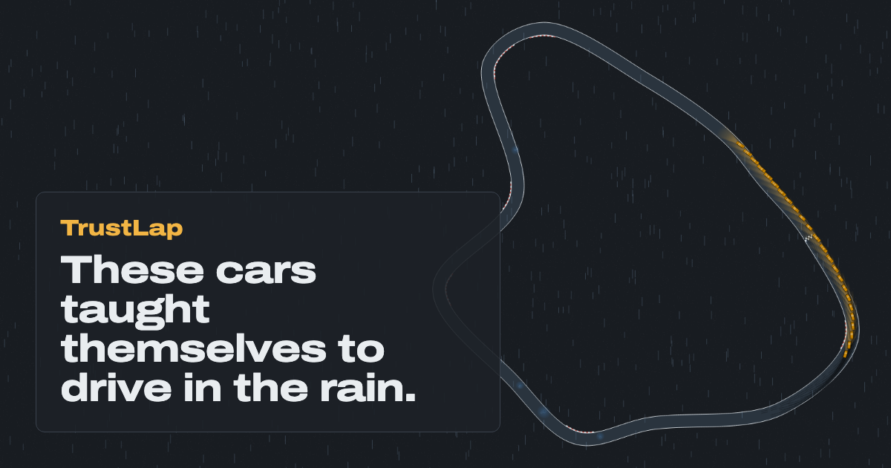

# TrustLap

AI race cars that teach themselves to drive in the rain, and know when they're unsure.

**Live demo: https://trustlap.vercel.app** · every car on the site is a neural network running in your browser.

<!-- metrics:start -->
- 65,536 cars simulated in parallel on one T4 GPU, 926× faster than the same JAX code on its CPU
- PPO drivers with population-based training and an automatic curriculum: 2,999M env steps in 83 min on a NVIDIA T4 GPU (Kaggle)
- A learned adaptation module estimates road grip from 1 s of motion: laps completed vs a non-adaptive driver on unseen tracks: puddles 38% vs 2%, wet 39% vs 4%, worn tires 86% vs 78%
- Honest headline: in the everything-at-once conditions the student crashes 5% fewer than the non-adaptive driver (95% CI 0% to 10%)
- Ensemble crash-risk estimate: calibrated (ECE 0.019) but weakly predictive (AUROC 0.58)
<!-- metrics:end -->



## What it is

A GPU-parallel driving simulator (tire slip, puddles, wind, tire wear, laggy steering, noisy sensors) written in JAX, a population of PPO drivers that learn by trial and error under an automatic curriculum, and a "student" driver that estimates road grip from the last second of motion (rapid motor adaptation). An ensemble of students estimates its own crash risk. The simulator and every trained network also run in the browser through an exact TypeScript port, so you can turn up the rain and watch them cope.

## How it works

```
Simulator (JAX) → Curriculum → Population (PPO + PBT) → Teacher → Student ensemble → Browser (TypeScript)
```

- `sim/`: Python package `trustlap`: tracks, dynamics, environment, PPO, PBT, curriculum, student, evaluation, export.
- `web/`: Vite + React + TypeScript site: physics port, MLP inference in a Web Worker, Canvas 2D renderer, charts.
- `docs/`: [spec](docs/SPEC.md), [decisions](docs/DECISIONS.md), [plain-English explainer](docs/EXPLAINER.md), [runbook](docs/RUNBOOK.md).

The full results (every condition, with confidence intervals) are on the [Results page](https://trustlap.vercel.app/results).

## Run it

```bash
# website
cd web && npm ci && npm run dev

# simulator, training and evaluation (Python 3.12)
cd sim && pip install -e ".[dev]" && pytest -q
python -m trustlap.track --out runs/banks
python -m trustlap.train --agent blind --env-steps 40e6 --out runs/blind
# … see docs/RUNBOOK.md, or sim/notebooks/train_full.ipynb for the full-size GPU pipeline
```

## Honest limitations

- Simulated only: a flat 2D world, one car type, two "axles" standing in for four tires. No claims about real cars.
- The published networks come from one training run each, at the design's budgets on one T4 GPU (Kaggle). Even so the curriculum stopped short of full difficulty (the Training lab shows where), and drivers fail sharply beyond it (e.g. ice, 2-step input delay, strong sensor noise).
- The adaptive student beats the non-adaptive driver where grip changes (puddles, wet roads, worn tires) and with a very heavy car, but loses on dry roads, in wind and with noisy sensors. Each teacher had two-thirds of the blind driver's training steps.
- The student does not notice a single puddle while driving through it, measured against the same runs without the puddle (Results).
- All students share one teacher policy, so their disagreement measures uncertainty about the road, not about the driving.

## Credits

Training-loop pattern from **PureJaxRL** (Lu et al., 2022). Teacher–student adaptation from **RMA** (Kumar, Fu, Pathak, Malik, 2021). Curriculum inspired by **Automatic Domain Randomization** (OpenAI et al., 2019). **Population Based Training** (Jaderberg et al., 2017). Tire model: Pacejka's **"Magic Formula"**. Font: Archivo (SIL Open Font License). This project combines and evaluates published techniques in a new setting with a custom simulator; it doesn't introduce new algorithms.

## License

MIT
